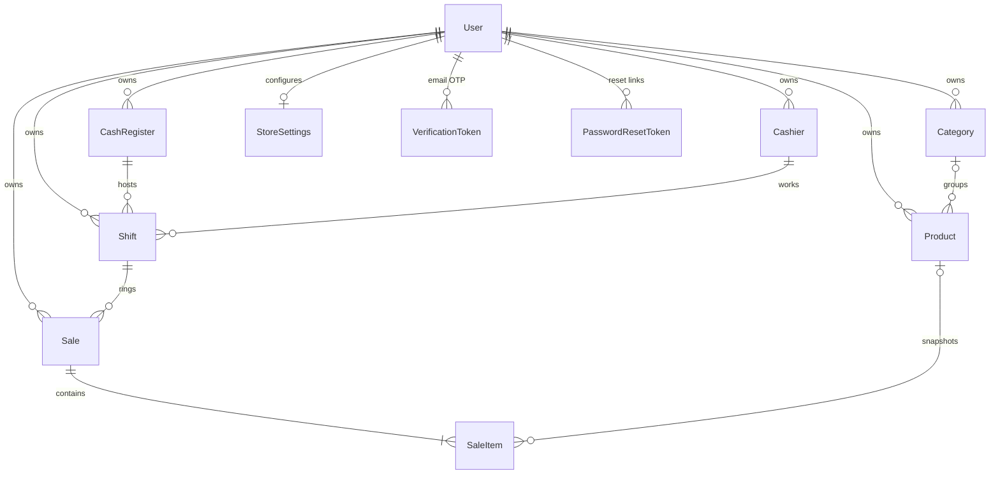

# VeloxPOS — Master Project Architecture Document (PAD) v1.0

**Classification:** Internal Engineering Reference
**Status:** DEFINITIVE, PRODUCTION-LOCKED BLUEPRINT
**Companion Document:** [`docs/veloxpos-implementation-plan.md`](docs/veloxpos-implementation-plan.md) (the reference→clone build plan)
**Last Updated:** 2026-10-26
**Audience:** Senior Engineers, Tech Leads, DevOps, and Onboarding Engineers
**Rule:** Every architectural decision in this document traces to a specific rationale. Nothing is here "because it's popular."

---

## Table of Contents

1. [System Overview & Decisions](#1-system-overview--decisions)
2. [High-Level System Topology](#2-high-level-system-topology)
3. [Application Architecture](#3-application-architecture)
4. [Data Architecture](#4-data-architecture)
5. [Design System Reference](#5-design-system-reference)
6. [Security Architecture](#6-security-architecture)
7. [Testing Strategy](#7-testing-strategy)
8. [Build & Deployment](#8-build--deployment)
9. [Developer Handbook](#9-developer-handbook)
10. [Known Issues & Outstanding Tasks](#10-known-issues--outstanding-tasks)
11. [Key Files Reference](#11-key-files-reference)
12. [Glossary](#12-glossary)

---

## 1. System Overview & Decisions

### 1.1 Document Metadata & Purpose

VeloxPOS is a self-hosted Spanish-language retail point-of-sale web application,
built as a **functional superset** of the Base44-hosted reference
`https://veloxposretail.base44.app/` with measured visual parity. This PAD is
the single source of truth for the codebase: onboarding, debugging, tech-choice
review, and replication all start here. Evidence for the reference claims lives
in `docs/veloxpos-implementation-plan.md` (computed styles + screenshots
captured live on 2026-10-26).

How to use this document: a new engineer reads §2–§4 in order; a reviewer of a
tech choice jumps to its ADR in §1.3; a security reviewer reads §6 against the
code; an agent follows `AGENTS.md` for operations and this document for the why.

### 1.2 Technology Stack Summary

| Layer | Technology | Version | Key Rationale |
|---|---|---|---|
| Web framework | Next.js (App Router, `output: "standalone"`) | ^16.4.2 | One deployable server; SPA rewrites give the reference's PascalCase routes; the build doubles as the type gate |
| UI runtime | React | ^19 | Concurrent views under one shell; `useSyncExternalStore` for the chunk-safe data cache |
| Language | TypeScript (strict) | ^5 | `noEmit` typecheck is a hard gate; `unknown` over `any` |
| Styling | Tailwind CSS (CSS-first, no config file) | ^4 | `@theme` token pins; the v4 trap list is documented and enforced (`docs/Tailwind-V4-Validation-Report.md`) |
| Primitives | shadcn/ui + Radix | latest | Accessible dialog/select/toast; owned, not themed-over |
| Charts | Recharts | ^3 | The reference's own charting library (measured off its compiled DOM) — parity for free |
| Client state | Zustand | ^5.0 | ONE store (§3.1); selectors + `useSyncExternalStore` cache |
| Validation | Zod | ^4.6 | Single boundary schema module; `.partial()` PATCH discipline via `sentKeysPatch` |
| ORM / DB | Prisma + SQLite | ^6.19 | Zero-config file DB; `db-path.ts` anchors relative `file:` URLs schema-first |
| Auth | Hand-rolled scrypt + HMAC cookie | — | No dependency; rate-limited; 7-day sessions (ADR-004) |
| Unit tests | Vitest | ^5.0 | Pure-seam coverage; `*.test.ts` only |
| E2E | Playwright | ^1.63 | Drives the PRODUCTION standalone build on :3100 |
| Package manager | Bun | 1.3 | `bun.lock` is authoritative |

### 1.3 Architecture Decision Records (ADRs)

**ADR-001: Single-page shell + route rewrites (no per-route pages)**

- **Context:** The reference is a Base44 SPA whose views live at PascalCase
  paths (`/POS`, `/Dashboard`, `/Inventory`, `/Sales`, `/Registers`,
  `/Cashiers`, `/Reports`, `/StoreSettings`). Cloning it as eight Next.js pages
  would change the navigation model (full RSC round-trips) and complicate
  shared state.
- **Decision:** One page (`src/app/page.tsx`) — auth gate → shell → view
  switcher — with `next.config.ts` rewrites mapping every reference path onto
  `/`. `src/lib/router.ts` is the single view↔path map (unit-pinned).
- **Rationale:** Preserves the reference's instant client-side navigation and
  URL semantics exactly; one hydration gate; one data pre-warm seam.
- **Consequences:** All views are client components under one bundle graph;
  deep-linking works via `viewFromPath(location.pathname)` + popstate sync.
- **Alternatives rejected:** Per-route `page.tsx` files (RSC overhead per nav,
  diverges from the reference's feel); a catch-all route (loses the
  explicit path pinning).

**ADR-002: Integer cents + basis-point tax rates (no floats, no decimals lib)**

- **Context:** The reference prices (e.g. $18.50, IVA 16%) must reproduce its
  ticket math exactly: 1× Coca-Cola = subtotal $18.50, IVA $2.96, total
  $21.46. Binary floats cannot represent 0.1.
- **Decision:** Every monetary column is `Int` cents; tax rate is `Int`
  basis-points-of-a-percent (16% → `1600`); half-up rounding to the cent lives
  ONLY in `src/lib/money.ts`.
- **Rationale:** Exact integer math for the reference's worked example; SQLite
  stores integers losslessly; no decimal.js dependency for one operation.
- **Consequences:** All boundaries convert at the seam (`parseMoneyToCents`);
  the reference's own ticket is a permanent unit fixture.
- **Alternatives rejected:** Floats (rounding drift); Prisma `Decimal`
  (serialized as string, no arithmetic); a decimals library (unnecessary).

**ADR-003: The shift lifecycle is transactional server state**

- **Context:** Selling must be gated on an open turno (the reference's own
  empty state says so), and its cashier picker ships broken (zero options) —
  the clone must make the lifecycle real.
- **Decision:** `src/lib/server/pos.ts` owns `openShift` (guarded twice:
  pre-check + inside the transaction against concurrent opens),
  `closeShift` (expected = float + cash sales; difference = counted −
  expected), and `checkout` (open-shift gate → per-line guarded stock
  decrement → Sale + SaleItems, all in one `prisma.$transaction`).
- **Rationale:** A half-sale (stock gone, no sale row) must be impossible;
  the register/cashier exclusivity must survive races.
- **Consequences:** No CRUD shortcut for shifts/sales; the UI refetches
  collections after every command.
- **Alternatives rejected:** Pure CRUD routes + client-side gating
  (bypassable, race-prone); DB triggers (opaque, untestable in Vitest).

**ADR-004: Hand-rolled auth (scrypt + HMAC cookie), kept from the scaffold**

- **Context:** The inherited scaffold shipped a complete, hardened auth stack
  (register → 6-digit in response, verify, login, forgot/reset, change
  email/password, delete account, rate limiting) with zero dependencies.
- **Decision:** Keep it verbatim; trim the user table to the POS-relevant
  fields (id, email, passwordHash, fullName, emailVerified).
- **Rationale:** Field-tested code (its behaviors were e2e-pinned in the
  scaffold lineage); self-hosted friendly (no SMTP — the verify code and reset
  link ride the API response); the reference itself is email+OAuth.
- **Consequences:** OAuth buttons on the login card are visual parity only —
  they answer an honest "not configured" toast.
- **Alternatives rejected:** NextAuth/BetterAuth (dependency + adapter weight
  for a single-tenant POS); unauthenticated demo mode (fails the reference
  parity contract).

**ADR-005: Dark-only app shell with two runtime theme colors**

- **Context:** The reference is a dark POS with a light login page, and its
  Ajustes exposes exactly two configurable colors (measured defaults
  `#6366f1` / `#8b5cf6`).
- **Decision:** `globals.css` pins one dark theme (no `.dark` variant, no mode
  toggle); the store's two colors are runtime `--pos-primary` /
  `--pos-gradient-to` RGB triplets applied on `<html>` by the shell and the
  Ajustes view; gradients consume them via the `pos-gradient` utilities.
- **Rationale:** Matches the reference exactly; kills the whole light/dark
  FOUC class; keeps v4's "no var() chains in @theme" trap satisfied (raw
  triplets in `:root`, consumed in `@theme`).
- **Consequences:** There is no light mode; login/reset manage their own light
  surfaces (and set the body bg while mounted).
- **Alternatives rejected:** Full theme system with accents (scaffold
  inheritance — dead weight for this domain).

**ADR-006: The working mobile drawer is a superset mandate, e2e-pinned**

- **Context:** Measured live (390×844, 2026-10-26): the reference's 220px
  sidebar stays fixed-open on phones, covers the content, and offers no
  hamburger/drawer/backdrop — its mobile navigation is broken.
- **Decision:** `src/components/layout/mobile-chrome.tsx` ships the working
  pattern (app bar `lg:hidden`, slide-in drawer w-72 over a blurred backdrop,
  body-scroll lock, Esc/backdrop/lg-crossing close), and
  `tests/e2e/mobile-navigation.spec.ts` pins it plus a zero-horizontal-
  overflow assertion on all 8 routes at 390×844.
- **Rationale:** The user contract is "superset in function, parity in
  visuals" — a broken reference behavior is a defect to fix, not replicate.
- **Consequences:** Desktop parity is unchanged (`lg:` rail 220/68px); any new
  view must pass the overflow assertion.
- **Alternatives rejected:** Copying the reference's fixed sidebar (broken);
  a bottom tab bar (invents chrome the reference never had).

### 1.4 Reference Parity Ledger

| Surface | Reference behavior | Clone behavior |
|---|---|---|
| Routes/nav labels | 8 Spanish items, PascalCase paths | Identical (`tests/router.test.ts`) |
| Design tokens | `#080a14` bg, `#0e111f` cards, `#1e2235` borders, violet/indigo gradients, emerald charge button | Pinned in `globals.css` (measured computed styles) |
| Ticket math | 1× Coca-Cola → $21.46 | Unit-pinned (`tests/cart.test.ts`) |
| Seed data | 12 products, 6 categories, 2 cajas, 2 ventas (Cesar Martínez, Caja 1) | `prisma/seed.ts` (verbatim barcodes/prices/stock) |
| Mobile navigation | **Broken** (sidebar covers content) | **Fixed** — drawer + e2e pins |
| Cajeros CRUD | **Empty** (0 usuarios, dead dropdown) | **Working** — full CRUD + shift assignment |
| Login OAuth | Base44 hosted OAuth | Visual parity; buttons answer "not configured" (self-hosted) |

---

## 2. High-Level System Topology

```text
┌──────────────────────────────────────────────────────────────────────┐
│ Browser (Chromium/Firefox/Safari)                                     │
│  /login (light card)  ──►  /POS shell (dark SPA)                      │
│   Sidebar ≥lg │ MobileChrome <lg ──► 8 client views (Recharts)        │
└──────────────┬───────────────────────────────────────┬───────────────┘
               │ fetch (same-origin, cookie auth)       │
┌──────────────▼───────────────────────────────────────▼───────────────┐
│ Next.js standalone server (node .next/standalone/server.js)           │
│                                                                       │
│  rewrites: /POS /Dashboard /Inventory /Sales /Registers /Cashiers     │
│            /Reports /StoreSettings  →  /  (one page)                  │
│                                                                       │
│  /api/auth/*      scrypt+HMAC session; rate-limited; self-hosted OTP  │
│  /api/products|categories|registers|cashiers  (+/[id]) CRUD factories │
│  /api/shifts (+/[id]/close)      turno lifecycle (transactions)       │
│  /api/sales (+/[id])             checkout transaction + history       │
│  /api/reports/summary            period read model                    │
│  /api/settings/store             1:1 store settings                   │
│  /api/health                     liveness + DB probe (unauthenticated)│
│                                                                       │
│  instrumentation.ts: AUTH_SECRET boot guard (production exit 1)       │
└──────────────┬────────────────────────────────────────────────────────┘
               │ Prisma Client (schema-anchored db-path resolution)
┌──────────────▼────────────────────────────────────────────────────────┐
│ SQLite  <repo>/db/custom.db   (dev)   ·   db/e2e.db (playwright)      │
│ 9 models — User, Category, Product, CashRegister, Cashier, Shift,     │
│ Sale, SaleItem, StoreSettings (+ VerificationToken, PasswordResetToken)│
└───────────────────────────────────────────────────────────────────────┘
```

Single process, single file DB, no external services. Scaling story: one
store per deployment (typical for retail); SQLite WAL handles the write
volume; the in-memory rate limiter is per-process by design (documented).

---

## 3. Application Architecture

### 3.1 The Layer Model (the Golden Rule)

```
Layer 0: Pure seams (src/lib/money|cart|shifts|reports|router|validation)
         — NO React, NO I/O. Every domain rule lives here and is unit-pinned.
Layer 1: Infrastructure seams (src/lib/db|db-path|api|auth|data|store)
         — I/O and caches; no UI imports; api.ts is the ONLY fetch path.
Layer 2: Server surface (src/lib/server/*, src/app/api/*)
         — Zod boundary → delegates/transactions → Prisma; error mapper only.
Layer 3: Chrome + views (src/components/layout|views, src/app/page.tsx)
         — Renders seam results; NEVER computes domain numbers; ONE Zustand
           store; toasts for failure, never thrown render trees.
```

A dependency may only point downward (views → seams, server → validation).
The build's type gate + ESLint boundaries enforce this informally; the unit
tests enforce it structurally (seams import nothing above Layer 0).

### 3.2 Annotated Directory Structure

```
web-retail-pos/
├── src/
│   ├── app/
│   │   ├── page.tsx                ← THE authed app: gate → shell → view switch
│   │   ├── layout.tsx              ← metadata + viewport + Toaster (server)
│   │   ├── globals.css             ← the whole design system (@theme pins + @utility)
│   │   ├── login/page.tsx          ← light auth surface (Suspense-wrapped LoginSurface)
│   │   ├── reset-password/page.tsx ← reset leg (useSyncExternalStore token read)
│   │   ├── robots.ts / sitemap.ts  ← generated from src/lib/site.ts
│   │   └── api/
│   │       ├── auth/*              ← register/login/verify/forgot/reset/logout/me/…
│   │       ├── products|categories|registers|cashiers (+ [id])  ← 3-line factory shells
│   │       ├── shifts/route.ts     ← GET history + POST open
│   │       ├── shifts/[id]/close   ← POST close (expected/difference computed)
│   │       ├── sales/route.ts      ← GET history + POST checkout (transaction)
│   │       ├── reports/summary     ← period read model (?days=7|14|30|90)
│   │       ├── settings/store      ← 1:1 settings upsert/patch
│   │       └── health              ← liveness + db probe
│   ├── components/
│   │   ├── layout/sidebar.tsx      ← desktop rail 220/68px (≥lg)
│   │   ├── layout/mobile-chrome.tsx← the working drawer (<lg) — superset fix
│   │   ├── layout/nav-items.tsx    ← THE nav item markup + icon map
│   │   ├── auth/login-surface.tsx  ← sign-in / sign-up / verify / forgot screens
│   │   ├── views/*.tsx             ← the 8 views + shared.tsx primitives
│   │   └── ui/*                    ← shadcn primitives
│   └── lib/
│       ├── router.ts               ← view↔path map (pure, pinned)
│       ├── money.ts                ← cents↔strings, es-MX dates (pure, pinned)
│       ├── cart.ts                 ← lines + totals (pure, pinned)
│       ├── shifts.ts               ← turno rules (pure, pinned)
│       ├── reports.ts              ← aggregations (pure, pinned)
│       ├── validation.ts           ← every Zod schema (the boundary)
│       ├── store.ts                ← THE Zustand store
│       ├── data.ts                 ← collection cache + posApi commands
│       ├── api.ts                  ← fetch seam (timeout/offline classification)
│       ├── auth.ts                 ← scrypt/HMAC/rate-limit (pure) · server/auth.ts ← cookies
│       ├── db.ts + db-path.ts      ← Prisma client + schema-anchored URL resolution
│       └── server/
│           ├── http.ts             ← envelope, error mapper, route factories
│           ├── entities.ts         ← CRUD delegates (ownership-scoped)
│           ├── pos.ts              ← openShift/closeShift/checkout transactions
│           └── settings.ts         ← settings upsert/patch
├── prisma/
│   ├── schema.prisma               ← 9 models; cents + bp; cascade/SetNull map
│   └── seed.ts                     ← the reference store, idempotent
├── tests/
│   ├── *.test.ts                   ← Vitest seam pins (14 files / 138 tests)
│   └── e2e/                        ← Playwright (5 spec files / 24 tests)
│       ├── global-setup.ts         ← pushes+seeds db/e2e.db
│       ├── auth.setup.ts           ← one login → shared storageState
│       ├── auth.spec.ts navigation.spec.ts mobile-navigation.spec.ts
│       ├── terminal.spec.ts inventory.spec.ts
├── scripts/
│   ├── capture-screens.mjs         ← docs/screenshots generator
│   └── overflow-probe.mjs          ← horizontal-overflow finder (viewport arg)
└── docs/                           ← plan, TW4 report, DEPLOYMENT, screenshots/, ssh wrapper
```

### 3.3 Critical Code Patterns

**Pattern 1 — the checkout transaction (`src/lib/server/pos.ts`)**

```typescript
export async function checkout(userId: string, input: CheckoutInputResolved) {
  const shift = await activeShift(userId);
  if (!shift) throw new ValidationError("No hay turno activo. …");   // ① gate

  const rows = await db.product.findMany({ where: { userId, id: { in: ids } } }); // ② one read, no N+1
  // …per-line active + stock guards → ValidationError("Stock insuficiente…")

  return db.$transaction(async (tx) => {
    for (const line of lines) {
      const dec = await tx.product.updateMany({
        where: { id: line.productId, userId, stock: { gte: line.quantity } }, // ③ guarded decrement
        data: { stock: { decrement: line.quantity } },
      });
      if (dec.count === 0) throw new ValidationError(…);            // ④ race → abort whole sale
    }
    return tx.sale.create({ data: { …, ticketNumber: generateTicketNumber(),
      items: { create: lines.map(…) } }, include: { items: true } });         // ⑤ snapshot line names
  });
}
```

*Why:* the guarded `updateMany … stock >= qty` makes the stock race impossible
even between concurrent checkouts; the transaction makes a partial sale
impossible; names/prices are snapshotted onto SaleItem so master-data deletes
never corrupt history.

**Pattern 2 — the collection cache (`src/lib/data.ts`)**

```typescript
const cache = host.__posDataCache ?? new DataCache();   // globalThis singleton
host.__posDataCache = cache;                            // chunk-duplication guard

export function useCollection<T>(path: string | null): T | undefined {
  return React.useSyncExternalStore(cache.subscribe,
    () => (path ? cache.get<T>(path) : undefined), () => undefined);
  // + an effect that GETs once; concurrent callers share the in-flight promise
}
```

*Why:* one cache instance survives code-splitting (the Turbopack
store-duplication lesson); failures degrade to empty states — never throw into
the render tree; every mutation command refetches its collections so UI and
server cannot drift.

**Pattern 3 — the Zod boundary + sent-keys PATCH (`src/lib/validation.ts`, `entities.ts`)**

```typescript
const writes = sentKeysPatch(input, parsed);
// keeps ONLY keys the caller actually sent ∩ keys the schema parsed — a zod
// .default() materialized into `parsed` can never silently overwrite a column
// (the AH8 data-loss class; pinned by tests/sent-keys-patch.test.ts)
```

**Pattern 4 — the mobile drawer lifecycle (`src/components/layout/mobile-chrome.tsx`)**

Open state lives in the ONE store; while open: body scroll locked, Escape and
`matchMedia("(min-width: 1024px)")` change listeners registered; cleanup
restores everything. The drawer is mounted ONLY while open (no hidden-DOM
focus traps).

---

## 4. Data Architecture

### 4.1 Database Schema (Mermaid ER)



### 4.2 Data Models (money contract: Int cents; tax: Int bp)

| Model | Key fields | Notes |
|---|---|---|
| **User** | email (unique), passwordHash, fullName, emailVerified | owner root; cascade on delete |
| **Category** | name, `@@unique([userId, name])` | delete → products SetNull |
| **Product** | name, barcode `@@unique([userId, barcode])`, priceCents, costCents?, stock, minStock, taxRate=1600, unit, imageUrl?, active | low-stock = stock ≤ minStock |
| **CashRegister** | name `@@unique([userId, name])`, location, active | Caja 1/2 in seed |
| **Cashier** | name, email, phone, pin, active | CRUD the reference lacks |
| **Shift** | registerId, cashierId, openedAt/closedAt, openingFloatCents, closing/expected/differenceCents, status `open\|closed` | ONE open per register/cashier (app-enforced, tx-guarded) |
| **Sale** | ticketNumber `V-XXXXXXXX` (unique), cashier/register/shift SetNull, customerName, paymentMethod `cash\|card\|transfer`, subtotal/tax/totalCents, status | history rows survive deletes |
| **SaleItem** | saleId (cascade), productId? SetNull, name snapshot, unitPriceCents, quantity, taxRate, lineTotalCents | no userId — scoped via Sale |
| **StoreSettings** | 1:1 user; storeName, logoUrl?, address, phone, email, taxId, currency, primaryColor, secondaryColor, ticketFooter, cardProvider | GET upserts defaults |

### 4.3 Persistence Strategy

- **Path contract:** `DATABASE_URL="file:../db/custom.db"` — the Prisma CLI
  anchors it against `prisma/schema.prisma`; the runtime re-applies the same
  rule via `src/lib/db-path.ts` (16 unit pins), so dev/build/standalone all
  land on `<repo>/db/custom.db`. Production uses an ABSOLUTE path (documented).
- **Schema sync:** `prisma db push` (no migration journal for this product —
  `db:push` is the documented flow; seeds are idempotent).
- **Transactions:** only the POS writes (shift open/close, checkout) use
  `prisma.$transaction`; CRUD is single-statement by construction.

---

## 5. Design System Reference

### 5.1 Typographic System

System-UI stack only (the reference's own computed font): `ui-sans-serif,
system-ui, -apple-system, "Segoe UI", Roboto, …`. Weights 400/500/600/700/900
(COBRAR uses 900). Page h1 = 24px/700; nav labels 14px/500; ticket header
13px uppercase tracking-[0.2em].

### 5.2 Color Tokens (measured off the reference)

| Token | Hex | Usage |
|---|---|---|
| App background | `#080a14` | body canvas |
| Sidebar | `#0d0f1a` + border `#1e2235` | rail + drawer |
| Card | `#0e111f` (rgba(16,18,32,.9)) + `0 8px 32px rgba(0,0,0,.5)` | pos-card |
| Surface chip | `#141828` | inputs, chips, dialogs |
| Primary | `#6366f1 → #8b5cf6` gradient | brand chip, CTAs (runtime `--pos-primary`/`--pos-gradient-to`) |
| Success | `#059669 → #10b981` 135° gradient | COBRAR / Abrir Turno |
| Stat chips | `#10b981` `#8b5cf6` `#3b82f6` `#f59e0b` | KPI icons + same-hue glow |
| Success badge | bg `#dcfce7` / ink green-700 | Activo, Completada |
| Neutral badge | bg `#f1f5f9` / ink slate-700 | Cerrada |
| Text | `#e7e9ef` body; titles slate-500 (~4.1:1 — the documented a11y-superset deviation; the reference renders `#1e293b` ≈1.1:1) | |
| Login | bg `#f6f9fb`, white card, ink `#0f172a`, border `#e2e8f0` | light auth surfaces |

### 5.3 Component Primitives

shadcn/Radix (dialog, select, label, separator, toast, button, input, badge…)
as the primitive layer; the POS layer (`shared.tsx`) composes them:
`PageHeader`, `EmptyState`, `Badge`, `Chip`, `StatCard`, `GradientButton`,
`SuccessButton`, `IconButton`. Custom utilities live in `@utility` blocks only
(`pos-gradient`, `pos-gradient-success`, `pos-card`, `pos-card-register`,
`pos-slide-in`, `pos-skip-link`, `sf-alert-*`).

### 5.4 Motion

One keyframe: `pos-slide-in` (drawer, 220ms ease-out). Radix data-state
animations on dialogs/selects. No reduced-motion branch yet (§10).

---

## 6. Security Architecture

### 6.1 Security Rules (mandatory, with enforcement)

| Rule | Enforcement |
|---|---|
| All input is untrusted until Zod-parsed | `parseWith` at every route; `validation.ts` is the only schema source |
| No secret fields in any SELECT | `SESSION_USER_SELECT` whitelists columns; passwordHash never leaves the seam |
| Errors never leak internals | `toErrorResponse` maps known classes; unknown → 500 with server-side-only logging |
| Rate limiting on public auth routes | `checkRateLimit` 10/IP/15min (login, register, forgot, delete-account) with `Retry-After` |
| Parameterized queries only | Prisma client exclusively; zero raw SQL (health probe is `SELECT 1` constant) |
| No secrets in tree | `.env` git-ignored; deploy keys live outside the repo; boot guard fails on weak `AUTH_SECRET` |
| Ownership by construction | every delegate query is `where: { userId }`; pre-checks before mutation |
| Downloads (CSV) are safe | RFC 2183/5987 Content-Disposition builder; `nosniff` + `private, no-store` |

### 6.2 Security Utilities

`src/lib/auth.ts` (scrypt hash/verify, HMAC session tokens `body.mac`,
constant-time compares, in-memory fixed-window limiter, crypto-random OTP/reset
tokens) · `src/lib/server/auth.ts` (httpOnly/sameSite=lax cookie, secure flag
derived from request protocol, clientIp) · `src/instrumentation.ts`
(production boot guard: missing/weak secret ⇒ `process.exit(1)`).

### 6.3 Authentication & Authorization

- **Session:** HMAC-signed `{uid, iat, exp}` (7-day TTL) in an httpOnly,
  sameSite=lax cookie (`pos_session`); `requireUser()` gates every authed route;
  the shell gates the UI but NEVER trusts the client (the API is the gate).
- **Authorization:** single-tenant per `User` row — every query scopes by
  `userId`. There are no roles inside a store yet (any signed-in owner manages
  cashiers; §10).
- **Verification:** register creates an UNVERIFIED account; the 6-digit code
  rides the response (self-hosted delivery); login requires `emailVerified`.

### 6.4 Threat Model (top vectors)

| Vector | Mitigation |
|---|---|
| Credential stuffing / brute force | fixed-window limiter + scrypt cost + uniform errors (no user enumeration; register answers uniform 200 for existing verified emails) |
| Session theft | httpOnly + sameSite=lax + HMAC + short-ish TTL; `secure` in production |
| IDOR | every read/write scoped `userId`; item routes verify ownership BEFORE mutation |
| Stock races / double-spend | guarded `updateMany` decrement inside `$transaction` (ADR-003) |
| XSS | React escaping; no `dangerouslySetInnerHTML` outside the (removed) theme boot script; logo images are data-URL-validated (`dataUrlImage`: image MIME + base64 + size cap) |
| Dependency risk | minimal surface (no auth/network deps); lockfile committed; `scripts/dep-audit` lineage replaced by periodic `bun pm` review |
| CSV injection in exports | values are quoted-wrapped; Excel formula-prefix neutralization is a §10 task |

---

## 7. Testing Strategy

### 7.1 Test Distribution

| Category | Files | Tests | Location | Framework |
|---|---|---|---|---|
| Pure seams | 14 | 138 | `tests/*.test.ts` | Vitest 5 (node env) |
| E2E journeys | 5 | 24 | `tests/e2e/*.spec.ts` | Playwright (Chromium, production build) |

### 7.2 Test Patterns

- **Seam pins:** every pure module has a twin test file asserting behavior
  with independent truth (the reference's measured ticket is the canonical
  fixture — never recompute expected values with the code under test).
- **DB-path resolution:** fixture-based `mkdtemp` trees prove the
  schema-anchoring rule (16 pins) — the subtlest code in the repo.
- **E2E auth:** one login in `auth.setup.ts` → shared `storageState` (the
  limiter makes per-test logins flaky by design).
- **The mobile contract:** drawer presence/close semantics + per-route
  `scrollWidth ≤ clientWidth` at 390×844 — the superset's defining guarantee.
- **State isolation:** e2e runs against `db/e2e.db` (freshly pushed + seeded
  per run); `db/custom.db` is never touched by tests.

### 7.3 Coverage Thresholds

No configured thresholds. The practical rule: every pure seam 100% branch-
tested; every API route exercised by at least one e2e journey.

### 7.4 Pre-PR / Pre-Deploy Checklist

```bash
bun run lint         # 0 errors
bun run typecheck    # clean
bun run test         # 138 green
bun run build        # standalone succeeds
bun run test:e2e     # 24 green (boots the build on :3100)
```

---

## 8. Build & Deployment

### 8.1 Production Build

`bun run build` → `next build` + copies `.next/static` and `public/` into
`.next/standalone/` → run with `node .next/standalone/server.js` (PORT,
DATABASE_URL absolute, AUTH_SECRET, NEXT_PUBLIC_SITE_URL set before boot).
`outputFileTracingRoot` is pinned to the repo so the trace never escapes a
parent workspace.

### 8.2 Environment Variables

| Name | Required | Description | Default |
|---|---|---|---|
| `DATABASE_URL` | yes | SQLite `file:` URL; relative resolves schema-anchored; production should use absolute | `file:../db/custom.db` |
| `AUTH_SECRET` | **prod** | HMAC signing secret; boot guard exits if missing/weak (<16 chars or dev fallback) | dev fallback + warning |
| `NEXT_PUBLIC_SITE_URL` | no | canonical origin for metadata/sitemap/robots (inlined at build) | `http://localhost:3000` |
| `PORT` | no | standalone server port | `3000` |

### 8.3 Docker Configuration

`Dockerfile` (multi-stage bun build → standalone runtime, non-root) +
`docker-compose.yml` (service + healthcheck against `/api/health`). See
`docs/DEPLOYMENT.md`.

### 8.4 CI/CD Pipeline

No hosted CI. The local gate (§7.4) IS the pipeline; pushes go through the
SSH wrapper (`docs/ssh_git_wrapper_v3.py`) which re-verifies the remote ref
after pushing (`refs/heads/main == local HEAD`) and shreds the temp key.

---

## 9. Developer Handbook

### 9.1 Local Setup

Minimal: `bun install && cp .env.example .env && bun run db:push && bun run
db:seed && bun run dev` → `http://localhost:3000` (login `demo@veloxpos.mx` /
`Demo1234`). Full (with e2e): additionally `bun run build && bun run
test:e2e`.

### 9.2 Common Commands

| Command | Purpose |
|---|---|
| `bun run dev` | dev server :3000 (logs → dev.log) |
| `bun run db:push` / `db:seed` | schema / demo data (idempotent) |
| `bun run lint` / `typecheck` / `test` | the fast gates |
| `bun run build` / `start` | standalone build / serve |
| `bun run test:e2e` | Playwright vs the build (:3100) |
| `node scripts/capture-screens.mjs` | regenerate `docs/screenshots/` (server on :3000) |
| `node scripts/overflow-probe.mjs /Reports 390` | find horizontal overflow on a route at a viewport |

### 9.3 Code Style Rules

ESLint (next/core-web-vitals + react-hooks, incl. `set-state-in-effect`).
Conventions that differ from defaults: React 19 (no `forwardRef` in new code),
Tailwind v4 CSS-first (no config file), money as Int cents, Spanish UI copy,
`data-testid` on spec-touched elements, `@` path alias only.

### 9.4 Git Workflow

`main` only — Conventional Commits, atomic units. Push via the SSH wrapper
(never a resident key): see `docs/how-to-git-push-using-ssh-wrapper_SKILL.md`.
The wrapper dry-runs auth first (`--dry-run`), pushes `HEAD:refs/heads/main`,
verifies the remote ref, shreds key material.

---

## 10. Known Issues & Outstanding Tasks

| Priority | Issue | Impact | Status |
|---|---|---|---|
| HIGH | Single role: any account owner can manage everything (no cashier sub-accounts with scoped login) | Fine for one store owner; the reference has the same shape | Open (roadmap) |
| MEDIUM | In-memory rate limiter resets on restart; per-process only | Multi-instance deploys under-protect auth routes (documented single-instance scope) | Open |
| MEDIUM | CSV export does not neutralize leading `=`/`+`/`-`/`@` (Excel formula injection) | Local CSV handling risk only | Open |
| MEDIUM | `next.config.ts` carries `typescript.ignoreBuildErrors: true` (scaffold inheritance) | Build is not a full type gate — `bun run typecheck` is; flipping the flag is a follow-up once the remaining scaffold types are exercised in CI | Open |
| LOW | No `prefers-reduced-motion` branch for the drawer animation | Minor a11y polish | Open |
| LOW | Seed's second sale ($99.76) is a documented equivalent — the reference's $61.48 ticket composition is not observable from its UI | Seed data differs from reference in one unobservable row | Documented (plan §7) |
| LOW | `package-lock.json` (npm) is vestigial next to `bun.lock` | Contributor confusion only | Open |

---

## 11. Key Files Reference

| File | ~Lines | Purpose |
|---|---|---|
| `src/app/page.tsx` | 210 | Auth gate → shell → view switcher; runtime theme triplets |
| `src/app/globals.css` | 300 | The design system + v4 trap pins |
| `src/lib/router.ts` | 60 | THE view↔path map (pinned) |
| `src/lib/money.ts` | 95 | Cents/format seam (pinned) |
| `src/lib/cart.ts` | 100 | Cart + totals seam (pinned) |
| `src/lib/shifts.ts` | 70 | Turno rules seam (pinned) |
| `src/lib/reports.ts` | 170 | Aggregation seam (pinned) |
| `src/lib/validation.ts` | 215 | Every Zod schema |
| `src/lib/data.ts` | 300 | Collection cache + posApi commands |
| `src/lib/store.ts` | 110 | THE Zustand store |
| `src/lib/server/pos.ts` | 250 | Shift/checkout transactions |
| `src/lib/server/entities.ts` | 150 | CRUD delegates + sentKeysPatch |
| `src/lib/server/http.ts` | 225 | Envelope, error mapper, route factories |
| `src/lib/db-path.ts` | 120 | Schema-anchored DB URL resolution (16 pins) |
| `src/components/layout/mobile-chrome.tsx` | 165 | The working drawer (superset fix) |
| `src/components/views/terminal-view.tsx` | 400 | The POS terminal |
| `prisma/schema.prisma` | 230 | 9 models, money contract |
| `prisma/seed.ts` | 200 | Reference store data |
| `playwright.config.ts` / `vitest.config.ts` | 75/30 | Test layers |

---

## 12. Glossary

| Term | Meaning |
|---|---|
| **Turno** | Shift — an opened register session (cashier + opening float) gating all selling |
| **Caja** | Cash register (the physical/drawer entity) |
| **Cajero** | Cashier — staff member who works a turno |
| **Fondo de caja** | Opening float — cash placed in the drawer at shift start |
| **COBRAR** | The charge action (terminal checkout) |
| **IVA** | Mexican VAT; per-product basis-point rate (default 16% = 1600 bp) |
| **Ticket** | A sale — numbered `V-XXXXXXXX` |
| **Centavos convention** | All money at rest is integer cents; rates are integer basis points |
| **The superset mandate** | Parity in visuals, superiority in function — reference defects (mobile nav, cashier CRUD) are fixed and pinned, never copied |
| **Seam** | A pure public boundary where behavior is tested (cart, shifts, reports, money) |
