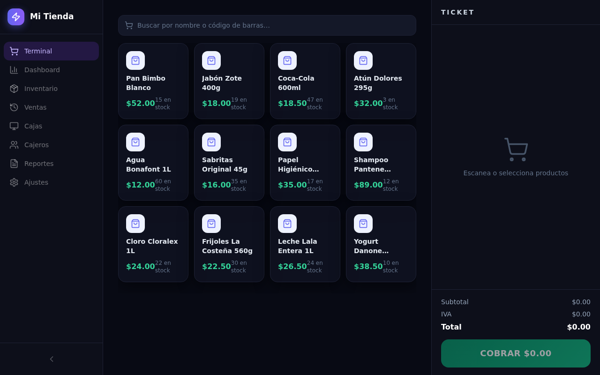
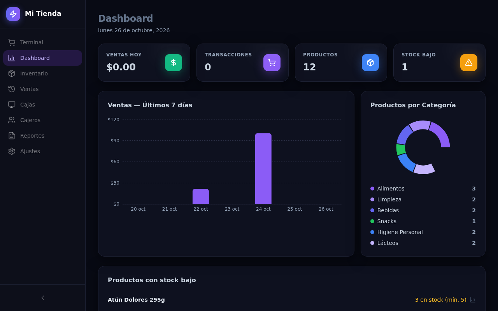
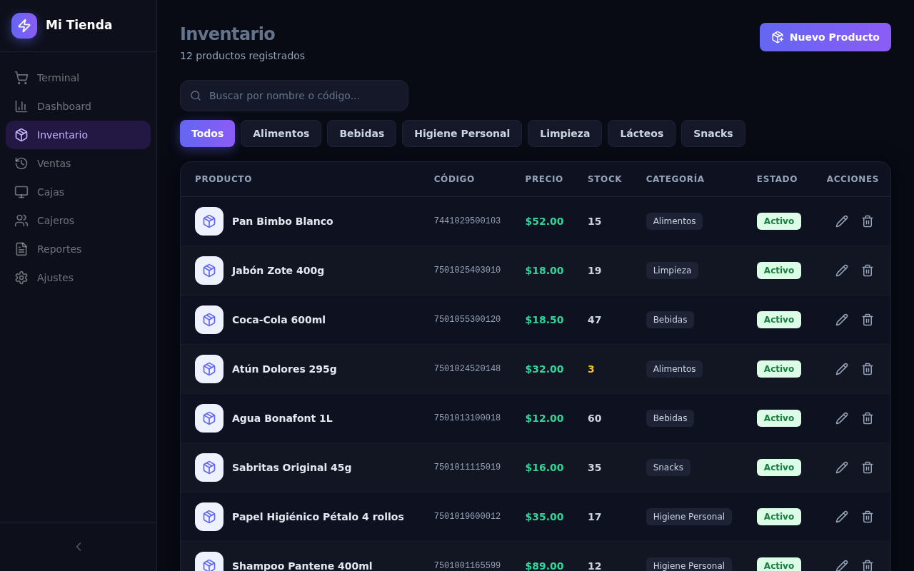
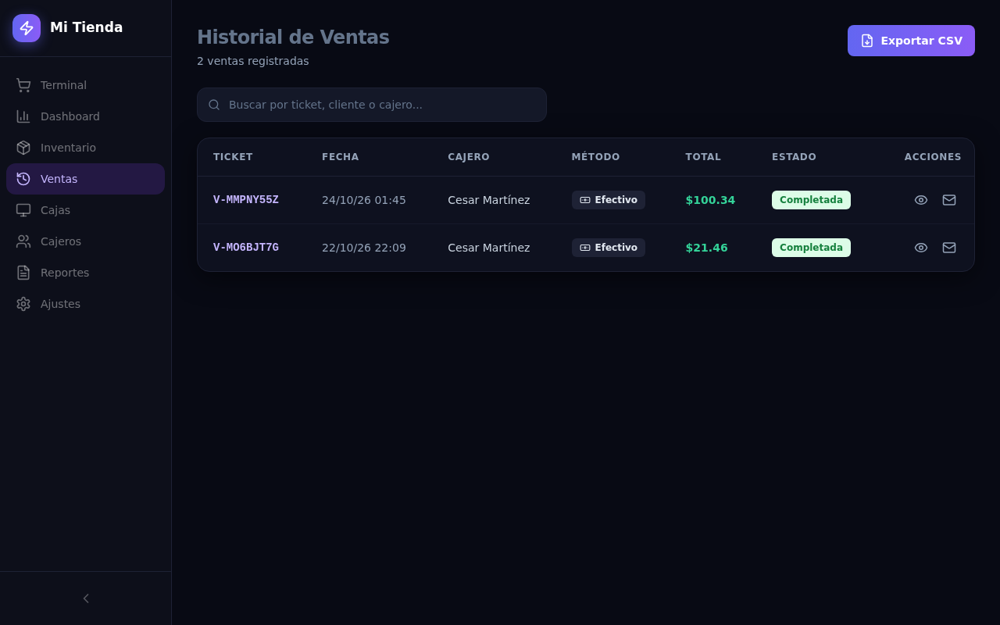
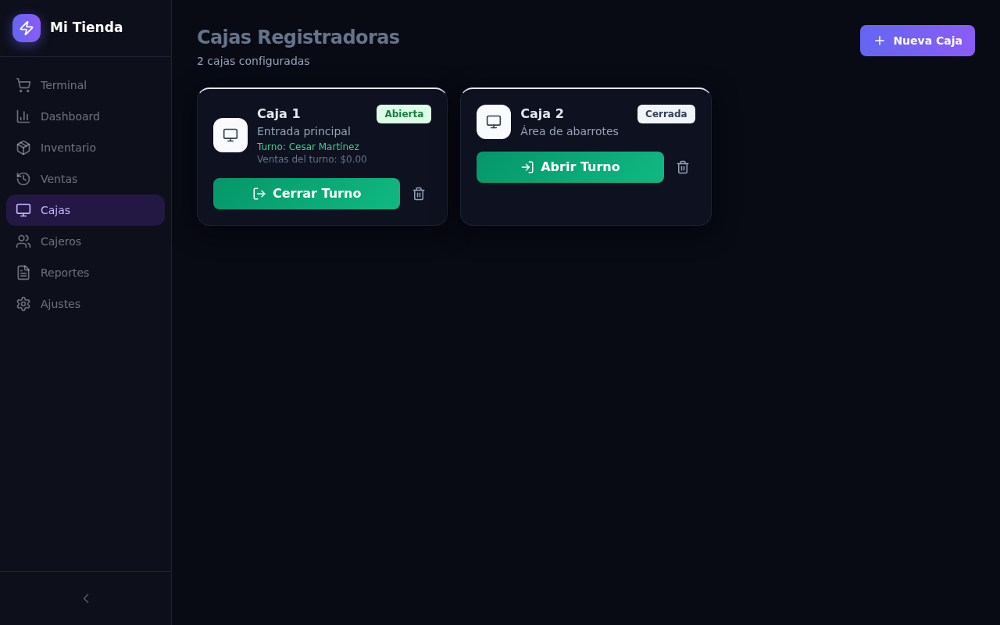
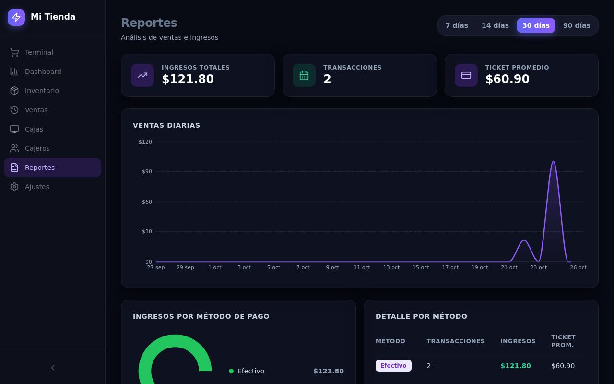

# VeloxPOS — Punto de Venta

     

**VeloxPOS** — sistema de punto de venta auto-alojado para tiendas de retail:
Terminal de venta, Inventario, Ventas, Cajas con turnos, Cajeros y Reportes.

A production-ready, self-hosted clone (**functional superset**) of the
Base44-hosted reference [`veloxposretail.base44.app`](https://veloxposretail.base44.app/),
rebuilt as a single Next.js application you fully own: your database, your
data, your deployment. Visual parity was measured from the live reference
(computed styles, not screenshots); the places where the reference is broken —
its mobile navigation covers the content below 1024px and its cashier/shift
flow ships with no working cashier management — are shipped **working** here
and pinned by tests.

| | | |
|---|---|---|
|  |  |  |
|  |  |  |

## Key features

| Feature | What it does |
|---|---|
| 🛒 **Terminal** | Product grid + barcode/name search, ticket cart with quantity steppers, COBRAR → payment dialog (Efectivo with change, Tarjeta, Transferencia), atomic checkout with live stock decrement |
| 📊 **Dashboard** | Ventas Hoy / Transacciones / Productos / Stock Bajo KPIs, 7-day sales chart, category donut, low-stock list (Recharts) |
| 📦 **Inventario** | Product CRUD with barcodes, categories, cost/price, stock minimums, IVA rate per product, unit, active toggle |
| 🧾 **Ventas** | Ticket history with search, ticket detail dialog (the reference's receipt layout), CSV export |
| 🖥️ **Cajas** | Register cards with the shift lifecycle: Abrir Turno (cashier + float) → sell → Cerrar Turno (counted vs expected, difference computed) |
| 👥 **Cajeros** | Cashier CRUD + Turnos Recientes history (the reference ships this view empty) |
| 📈 **Reportes** | 7/14/30/90-day toggle, revenue/transactions/average-ticket KPIs, daily area chart, revenue by payment method |
| ⚙️ **Ajustes** | Store info, logo, currency, RFC, live theme colors, ticket footer, card provider, category management |
| 📱 **Working mobile nav** | Hamburger → slide-in drawer below `lg` (backdrop, Esc, scroll-lock) — the reference's sidebar covers the content on phones; e2e-pinned |
| 🔐 **Auth** | Register → 6-digit verification (self-hosted: the code rides the response), login, forgot/reset password, rate limiting — scrypt + HMAC httpOnly cookies |

## Quick start

Prereqs: **Bun ≥ 1.3** (or Node ≥ 20 + npm equivalents), no external services.

```bash
git clone https://github.com/nordeim/web-retail-pos.git
cd web-retail-pos
bun install
cp .env.example .env        # defaults are correct for local dev
bun run db:push             # creates db/custom.db (git-ignored)
bun run db:seed             # seeds the reference store (12 products, 2 cajas, 2 ventas)
bun run dev                 # http://localhost:3000
```

**Demo login:** `demo@veloxpos.mx` / `Demo1234` — or register your own account
(the 6-digit verification code is displayed by the app; there is no SMTP).

Verify the setup:

```bash
curl -s localhost:3000/api/health   # {"status":"ok","db":"up","app":"veloxpos"}
```

## Tech stack

| Layer | Technology | Version | Purpose |
|---|---|---|---|
| Framework | Next.js (App Router, standalone) | 16.4 | One-page SPA shell + API routes |
| UI runtime | React | 19 | Client views under the authed shell |
| Language | TypeScript (strict) | 5.x | Full type safety end to end |
| Styling | Tailwind CSS (CSS-first) | 4.x | Dark design system in `globals.css` `@theme` |
| Components | shadcn/ui + Radix | latest | Dialogs, selects, toasts, buttons |
| Charts | Recharts | 3.x | Dashboard + Reports (the reference's own library) |
| State | Zustand | 5.x | ONE store: view, chrome, identity, colors |
| Validation | Zod | 4.x | The single API boundary |
| ORM / DB | Prisma + SQLite | 6.19 | 9 models, zero-config file DB |
| Auth | Hand-rolled scrypt + HMAC cookies | — | No auth dependency, rate-limited |
| Unit tests | Vitest | 5.x | Pure domain seams (138 tests) |
| E2E tests | Playwright | 1.63+ | 24 journeys vs the production build |

## Architecture

One page, one shell, pure seams:

```
/login (light) ──► /POS shell ──► Sidebar | MobileChrome ──► 8 views (client)
                        │                              │
                        └── /api/auth/me (gate)        └── src/lib/data.ts (cache)
                                                              │
              Zod-validated API routes ── src/lib/server/* ── Prisma/SQLite
              (products, categories, registers, cashiers,
               shifts + close, sales + checkout, reports, settings)
```

- **Pure seams** (`src/lib/money|cart|shifts|reports.ts`) hold every domain
  calculation; views render, they don't compute. Each seam is unit-pinned.
- **Checkout is a Prisma transaction**: open-shift gate → guarded stock
  decrement → sale + line items + `V-XXXXXXXX` ticket.
- **Routes** are the reference's PascalCase paths (`/POS`, `/Dashboard`,
  `/Inventory`, `/Sales`, `/Registers`, `/Cashiers`, `/Reports`,
  `/StoreSettings`) rewritten onto the single page in `next.config.ts`.

Full blueprint (ADRs, layer model, threat model, deployment):
[`Project_Architecture_Document.md`](Project_Architecture_Document.md).

## Environment variables

| Variable | Required | Default | Purpose |
|---|---|---|---|
| `DATABASE_URL` | yes | `file:../db/custom.db` | SQLite path; relative URLs resolve against `prisma/schema.prisma` at runtime (`src/lib/db-path.ts`) |
| `AUTH_SECRET` | **production** | dev fallback (warns) | HMAC session signing; the server refuses to boot in production without it (`openssl rand -hex 32`) |
| `NEXT_PUBLIC_SITE_URL` | no | `http://localhost:3000` | Canonical origin for metadata/sitemap/robots |

## Testing

```bash
bun run test          # Vitest — the pure seams (money, cart, shifts, reports,
                      #   validation, router, db-path, auth, api client, …)
bun run test:e2e      # Playwright — auth, navigation, MOBILE NAVIGATION,
                      #   the terminal sale journey, inventory/shift lifecycle.
                      #   Builds must exist first: bun run build.
```

E2E boots the standalone server on :3100 with its own `db/e2e.db` (schema-pushed
and seeded by `tests/e2e/global-setup.ts`) — your dev database is never touched.

## Deployment

The build produces a self-contained server (`output: "standalone"`):

```bash
bun run build
DATABASE_URL="file:/absolute/path/custom.db" \
AUTH_SECRET="$(openssl rand -hex 32)" \
NEXT_PUBLIC_SITE_URL="https://pos.example.com" \
PORT=3000 node .next/standalone/server.js
```

`docs/DEPLOYMENT.md` covers Docker (`Dockerfile` + `docker-compose.yml`), the
absolute-path DB rule, and the boot guard.

## Documentation index

| Document | Contents |
|---|---|
| [`AGENTS.md`](AGENTS.md) | High-signal operational facts for coding agents |
| [`CLAUDE.md`](CLAUDE.md) | Working conventions, standards, domain rules |
| [`Project_Architecture_Document.md`](Project_Architecture_Document.md) | The full engineering blueprint (ADRs, topology, security) |
| [`docs/veloxpos-implementation-plan.md`](docs/veloxpos-implementation-plan.md) | The reference→clone build plan with measured evidence |
| [`docs/Tailwind-V4-Validation-Report.md`](docs/Tailwind-V4-Validation-Report.md) | The v3→v4 trap list this codebase is hardened against |
| [`docs/how-to-git-push-using-ssh-wrapper_SKILL.md`](docs/how-to-git-push-using-ssh-wrapper_SKILL.md) | Pushing via the SSH wrapper |
| [`docs/screenshots/`](docs/screenshots/) | Desktop + mobile captures of every view |

## Troubleshooting

| Symptom | Cause / fix |
|---|---|
| `The server refuses to start` mentioning AUTH_SECRET | Production boot guard — set a real `AUTH_SECRET` (≥16 chars, not the dev fallback) |
| Empty Terminal with "No hay turno activo" | Working as designed — open a shift in **Cajas** (requires at least one active **Cajero**) |
| `db/custom.db` missing / schema drift | `bun run db:push && bun run db:seed` (idempotent) |
| E2E fails to find the server | Run `bun run build` first — Playwright drives the standalone build |
| 429 on login during testing | Rate limiter (10/15min/IP) — the e2e suite shares one storageState for this reason |
| Styles look unstyled/flat | A `tailwind.config.js` snuck back in — delete it; tokens live in `globals.css` |

## License

MIT — see the repository settings. The reference application remains the
property of its authors; this codebase shares no code with it.
