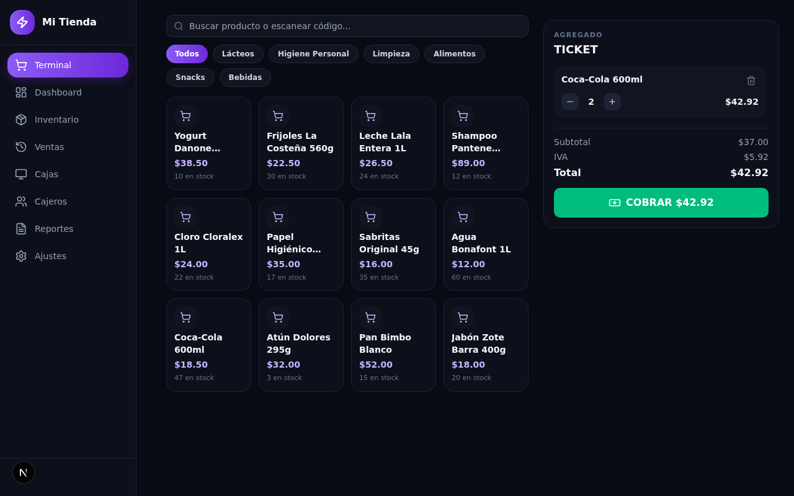
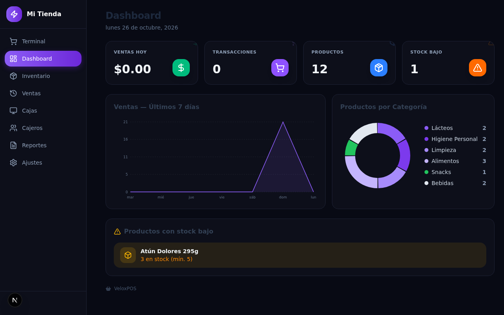
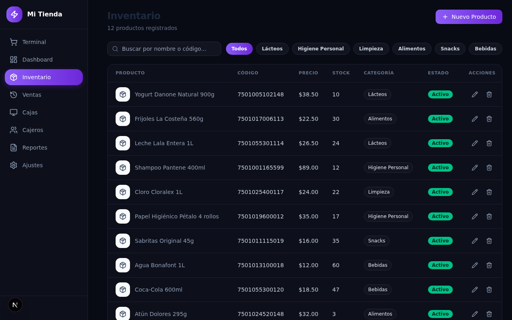
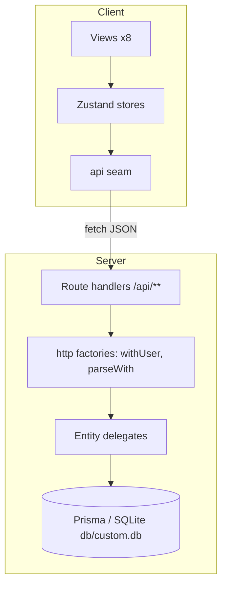

# VeloxPOS — Punto de venta, your store

      

**VeloxPOS** is a production-ready, self-hosted clone (functional superset) of
the [`veloxposretail.base44.app`](https://veloxposretail.base44.app/) point-of-sale
app, rebuilt as a single Next.js application you fully own: your database, your
auth, your deployment.

| | |
|---|---|
|  |  |
|  |  |

## Overview

The reference app is a Spanish retail POS — terminal, inventory, sales history,
registers ("cajas"), cashiers, reports, and store settings — but it lives
behind a hosted platform login with no source access, and several of its flows
are dead ends (its cashier page offers no way to create a cashier, so its own
Terminal can never open a shift). VeloxPOS rebuilds every surface at
measured visual parity and fills the gaps: a working mobile navigation drawer,
full cashier management, a complete shift lifecycle, and a live selling flow —
product grid, ticket, cash/card payment with change calculation, stock
decrement, and receipt history — all wired to real Prisma/SQLite persistence.
The places where the framework changed underneath (Tailwind v4's engine, Next
16's route-handler contracts, Turbopack's env pre-resolution) are documented
and pinned by tests rather than left to luck.

## Key features

| Feature | Description |
|---|---|
| 🖥️ Terminal de venta | Product grid with search + category chips, live ticket (qty ±), COBRAR with cash-change math or card, stock decrements atomically |
| 📊 Dashboard | Sales today, transactions, product count, low-stock count, 7-day sales chart, category donut, low-stock alerts |
| 📦 Inventario | Full product CRUD with barcode, category, price/cost, stock/min-stock, per-product IVA %, unit, active flag; search + category filters |
| 🧾 Historial de Ventas | Receipt list + per-ticket detail (items, subtotal/IVA/total, cashier, register), search by ticket/client/cashier |
| 🗄️ Cajas | Register cards with open/close shift lifecycle, opening float, closing count, delete guard while a shift is open |
| 👥 Cajeros | Cashier CRUD + recent-shifts table (the reference ships this page with no create path — a documented superset gap-fill) |
| 📈 Reportes | 7/14/30/90-day windows, revenue/transactions/average-ticket KPIs, daily series, per-method breakdown |
| ⚙️ Ajustes | Store identity, live accent-color theming, ticket footer, card-payment provider, category management |
| 📱 Mobile navigation | A working hamburger drawer (288px, 8 links, Esc/backdrop/route close, scroll lock) — the reference has none |
| 🔐 Auth | Email/password with scrypt hashing, HMAC session cookies, rate limiting, register→verify→reset flows; a reset revokes every pre-reset session (token version) |

## Architecture

One Next.js page + route rewrites; the client store syncs the view with the
URL. All server access flows through the API seam.



| Layer | Technology | Why |
|---|---|---|
| Framework | Next.js 16.4 (standalone) | One deployable server, route handlers + rewrites |
| UI | React 19 + Tailwind CSS 4 (CSS-first) | The reference's design language, pinned token-by-token |
| State | Zustand 5 | Two stores, selector subscriptions, no Context |
| API | Next route handlers + Zod 4 | Strip-mode validation, typed error mapper |
| DB | Prisma 6 + SQLite | Zero-ops persistence at `<repo>/db/custom.db` |
| Charts | Hand-rolled SVG | Zero dependencies, deterministic, pixel-controlled |
| Tests | Vitest 5 + Playwright | Unit seams + browser contracts (181 + 67 green) |
| Runtime | Bun 1.3 | Scripts, seed, and the standalone server |

## Quick start

Requirements: **Bun ≥ 1.3** (`curl -fsSL https://bun.sh/install | bash`), and a
Chromium install for e2e (`bunx playwright install chromium`).

```bash
git clone git@github.com:nordeim/web-retail-pos.git
cd web-retail-pos
bun install
cp .env.example .env          # DATABASE_URL + AUTH_SECRET (dev default ok)
bun run db:push               # create <repo>/db/custom.db
bun run db:seed               # owner + 12 products + registers + history
bun run dev                   # → http://localhost:3000
```

Verify setup:

```bash
curl -s localhost:3000/api/health   # {"status":"ok","db":"up","app":"veloxpos"}
```

Log in at `/login` with the seeded owner (`SEED_OWNER_EMAIL` /
`SEED_OWNER_PASSWORD` — see the seed note below), then open a shift in
**Cajas → Abrir Turno** and sell in **Terminal**.

### The seed identity

The seed mirrors the reference account the operator provisions. Credentials
are read from `SEED_OWNER_EMAIL` / `SEED_OWNER_PASSWORD` / `SEED_OWNER_NAME`
env vars; the **password default lives in `prisma/seed.ts`** because bun's
dotenv expands `$…` inside `.env` values (a `'$Abcd1234'` value arrives as an
empty string). Rotate the seeded password immediately on any shared deploy —
it is a demo seed, not a secret store.

## Environment variables

| Variable | Required | Purpose |
|---|---|---|
| `DATABASE_URL` | yes | `file:../db/custom.db` (schema-anchored → `<repo>/db/custom.db`) |
| `AUTH_SECRET` | prod | 64-hex HMAC secret; a missing/blank/placeholder value (incl. this example file's) is a fatal boot error in production |
| `NEXT_PUBLIC_SITE_URL` | no | Canonical origin for metadata/sitemap |
| `RESET_INAPP_DELIVERY` | no | `1` = the forgot-password response carries the one-shot reset URL (the no-SMTP demo posture; non-production defaults on, production defaults OFF) |
| `AUTH_PROXY_HOPS` | no | Trusted proxies in front of the app (default 0) — the rate limiter reads that hop from the RIGHT of `x-forwarded-for`, never the client-controlled first hop |
| `SEED_OWNER_EMAIL` / `SEED_OWNER_PASSWORD` / `SEED_OWNER_NAME` | no | Seed identity overrides (see above) |

## Testing

```bash
bun run test        # unit layer — pure seams + source pins (vitest)
bun run test:e2e    # browser layer — boots the standalone build on :3100
```

- e2e requires a fresh production build first (`bun run build`).
- The e2e database (`db/e2e.db`) is force-reset and reseeded on every run.
- Auth is shared via a storageState (one setup login — the endpoints are
  rate-limited); specs needing the logged-out surface opt out explicitly.
- The a11y smoke runs axe (critical/serious) minus `color-contrast` — the
  reference's own measured low-contrast headings are a disclosed parity
  deviation, not a silent failure.

## API reference

All endpoints are session-authenticated (cookie) except `/api/health` and the
auth pair. Errors: 400 invalid · 401 unauthenticated · 404 not found · 409
conflict (duplicate open shift) · 422 business rule (insufficient stock,
short cash, burnt OTP) · 413 oversized body · 415 non-JSON body.

| Endpoint | Methods | Description |
|---|---|---|
| `/api/auth/login · logout · me · register · verify-email` | POST/GET | Session lifecycle |
| `/api/auth/forgot-password · reset-password` | POST | The one-shot reset flow |
| `/api/products` · `/api/products/[id]` | GET/POST · PATCH/DELETE | Inventory (name+owner unique) |
| `/api/categories` · `/api/categories/[id]` | GET/POST · PATCH/DELETE | Product categories |
| `/api/registers` · `/api/registers/[id]` | GET/POST · PATCH/DELETE | Cajas (delete guarded while a shift is open) |
| `/api/cashiers` · `/api/cashiers/[id]` | GET/POST · PATCH/DELETE | Cashiers (delete guarded while a shift is open) |
| `/api/shifts` | GET/POST | Turno list + open (409 on duplicate open register) |
| `/api/shifts/[id]/close` | POST | Close a turno with the counted cash |
| `/api/sales` · `/api/sales/[id]` | GET/POST · GET | Receipts (open shift required; stock decremented transactionally) |
| `/api/settings` | GET/PATCH | Store settings singleton (colors drive the live theme) |
| `/api/dashboard` | GET | KPIs + 7-day series + category split + low stock |
| `/api/reports?days=7\|14\|30\|90` | GET | Windowed revenue analytics |
| `/api/health` | GET | Liveness + DB probe (public) |

## Design system (reference-measured tokens)

| Token | Value | Usage |
|---|---|---|
| Canvas | `#080a14` | App background |
| Surface / border | `#0d0f1a` / `#1e2235` | Cards, sidebar, tables |
| Primary gradient | violet → deep violet (`--vx-secondary` → `--vx-primary-deep`) | Brand chip, active nav, primary CTAs |
| Success / warning | emerald / amber | Abrir Turno, Activo/Completada pills, stock-bajo |
| Radius | 12px controls, 16px cards | rounded-xl / rounded-2xl |
| Auth surface | light (`#eef2f7` → `#e2e8f0`) | login/signup/reset only |

The store's **Color primario/secundario** settings write `--vx-primary` /
`--vx-secondary` at runtime — Personalización is live theming.

## Documentation map

- `docs/reference-investigation.md` — the live reference dossier (routes,
  data, money model, design tokens, evidence labels)
- `docs/implementation-plan.md` — the replication plan (stack decisions,
  trap rules, delivery bar)
- `docs/Tailwind-V4-Validation-Report.md` — the v3→v4 trap log this build
  guards against
- `docs/reference-evidence/` — live reference captures · `docs/screenshots/`
  — this app's own evidence set (`scripts/capture-screenshots.sh`)
- `docs/remediation-plan-v2.md` — the Session-V2 audit + parity
  remediation record (findings → TDD pins → gate evidence)
- `AGENTS.md` / `CLAUDE.md` — agent working contracts ·
  `Project_Architecture_Document.md` — the full PAD · `worklog.md` — the
  session journal · `web-retail-pos_SKILL.md` — the engineering skill

## Troubleshooting

| Symptom | Cause & fix |
|---|---|
| Empty store after login (no products) | A stray `<parent>/db/custom.db` — Turbopack pre-resolves the relative `file:` URL one level off and next dev creates it. Delete the stray; `src/lib/db-path.ts` (v3 hardening) now prefers the repo-owned db. |
| `bun run test:e2e` boots a stale app | The webServer runs `.next/standalone/server.js` — run `bun run build` first. |
| `bun run db:seed` seeds the wrong owner | bun auto-loads `.env`; pin `SEED_OWNER_*` in the calling env (the e2e global-setup does exactly this). |
| Login always 401 after a reseed | The session cookie references a wiped user id — log out / clear cookies. |
| Drawer gaps look wrong on mobile | You reintroduced `space-y-*` with margin children (Tailwind v4 trap 4) — use `flex gap-*`; `tests/tailwind-traps.test.ts` fails first. |

## License

No standalone LICENSE file ships in this repository (the upstream scaffold
carried none). Treat the code as the operator's private property; add a
license file before any redistribution. The reference application's UI copy
and design language are replicated for the operator's own authorized
self-hosting per `docs/reference-investigation.md` §1 (authorization note).
